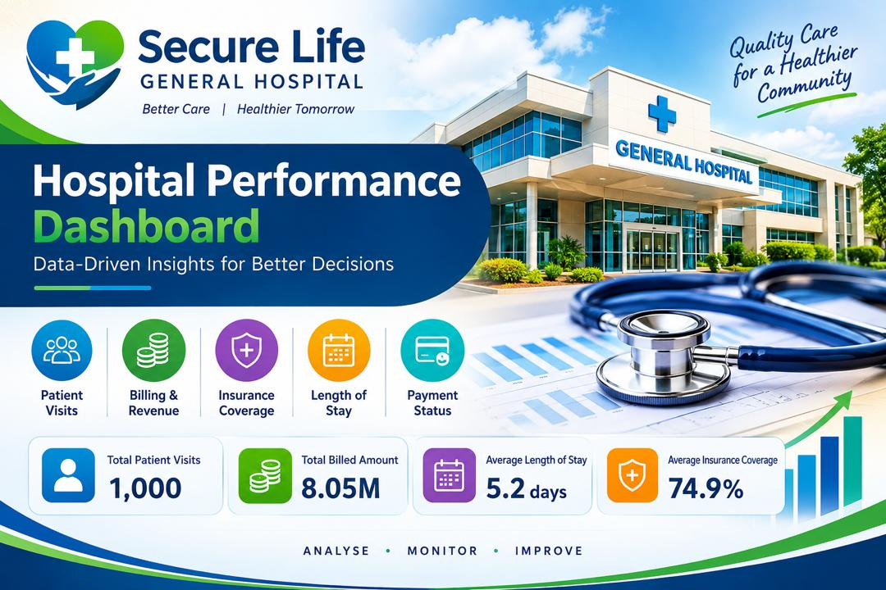
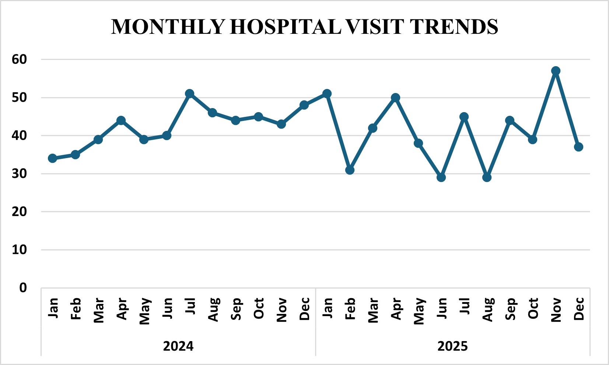
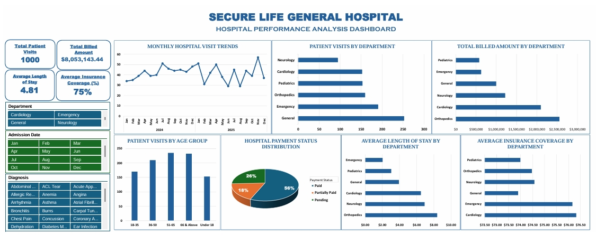

# TRANSFORMING SECURE LIFE GENERAL HOSPITAL PATIENT DATA INTO ACTIONABLE INSIGHTS

## EXECUTIVE SUMMARY

Secure Life General Hospital recorded **1,000 patient visits** between January 2024 and December 2025 and billed a total of $8.05 million. About **$3.48 million (43.3%)** of that amount belongs to bills that are still Pending or only Partially Paid. This report studies the hospital’s admission, billing and insurance records and presents the results in an Excel dashboard, so that management can see how the hospital is performing and where action is needed.

**Organisation:** Secure Life General Hospital, with six clinical departments.

**My role:** Data Analyst.

**Data used:** 1,000 patient visits and 11 fields, with admissions from 1 January 2024 to 28 December 2025.

**Tools:** Excel for the analysis and the dashboard.

**Deliverables:** an Excel dashboard workbook with four headline figures and seven charts, and this report.

## Headline findings
- Patients and income come from different places. General treats the most patients (252 visits) but produces only 12.3% of the billing. Orthopedics and Cardiology treat 31% of patients but produce 57.7% of the billing.
- Unpaid bills are the main risk. Only 56.4% of visits are fully paid. A further 25.7% are pending and 17.9% are partially paid.
- Patients with more insurance cover tend to pay in full more often. Where there is no cover, 27% of visits are fully paid. Where cover is 90% or more, 67% are fully paid. This is a pattern in the data. It does not prove that insurance cover is the reason.
- Longer stays mean bigger bills. The two rise together very closely (a correlation of 0.89), and Orthopedics has the longest stays at 8.4 days.
- The end of 2025 needs attention. Pending bills rose to 33.8% of visits admitted in the last quarter of 2025, compared with 20.5% in the second quarter.

## PROJECT BACKGROUND
Secure Life General Hospital treats patients in six departments: Cardiology, Emergency, General, Neurology, Orthopedics and Pediatrics. Management had noticed changes in admissions, a growing number of unpaid medical bills and uneven insurance coverage. There was no single report showing how the hospital was performing, both in its day-to-day work and in its finances.
The hospital supplied its patient admission, billing and insurance records and asked for one combined view. The aim was to let management monitor performance, follow payments and make better decisions. The brief also asked for extra insight, beyond the ten set questions, wherever it would help decision-making.

One rule shaped the whole analysis: **each row in the data is one patient visit, not necessarily one person**. A patient who returns appears more than once, so every count in this report is a count of visits.

## PROBLEM STATEMENT
Management of Secure Life General Hospital has observed a change in patient admissions, outstanding medical bills and variations in insurance coverage across its departments. The hospital wants to use its admission, billing and insurance data to understand operational performance, monitor payments and improve decision-making. It currently lacks a consolidated report that gives a clear picture of its operational and financial performance.
As the data analyst, my task was to turn the raw data into insights and to build a dashboard that helps management monitor performance. The project answers ten management questions and adds extra analysis where it supports a decision. It covers admissions from January 2024 to December 2025 and is limited to the fields in the hospital’s dataset.
The ten questions are:
1.	How many patient visits has the hospital recorded?
2.	Which departments receive the highest number of patients?
3.	Which departments generate the highest total bills?
4.	What is the average length of stay across departments?
5.	What proportion of bills is paid, pending or partially paid?
6.	How much has the hospital billed, and how much remains outstanding?
7.	How does insurance coverage vary across departments and diagnoses?
8.	Which age groups account for the most visits?
9.	How do admissions and billing amounts change over time?
10.	Which areas may need management attention?
    
## ABOUT THE DATASET
The dataset holds 1,000 patient visits and 11 fields, with no missing values. All 1,000 Patient IDs (PAT-3001 to PAT-4000) are unique, so the analysis counts visits. The data has no separate, verified identifier that links repeat visits by the same person, so this report treats each row as one visit and does not claim to count individual people.

## Data quality checks
Before any analysis, the data was checked in four ways. It passed every check.

- **Completeness:** there are 1,000 rows and no missing value in any field.
- **Uniqueness:** every Patient ID is different. Names do repeat (there are 684 different names), but a name is not a reliable way to identify a person, so no attempt was made to count individuals.
- **Date logic:** no patient is discharged before being admitted. Stays last from 1 to 14 days. Admissions run from 1 January 2024 to 28 December 2025, and the last discharge is on 3 January 2026.
- **Consistency:** each diagnosis belongs to exactly one department. All Pediatrics patients are 17 or younger, and no other department treats anyone under 18.

## Fields created for the analysis
Five extra fields were worked out from the original data:
- **Length of stay (days):** the discharge date minus the admission date.
- **Insurance covered ($):** the total bill multiplied by the coverage percentage.
- **Patient share ($):** the total bill minus the amount covered by insurance.
- **Age group:** five bands, namely Under 18, 18 to 35, 36 to 50, 51 to 65 and 66 and above. These are the same bands used in the dashboard, and every age figure in this report uses them.
- **Admission month and quarter:** taken from the admission date and used for all the trend analysis.

## TOOLS AND METHODOLOGY
The work followed four steps:
1.	**Extract and validate:** I loaded the records, ran the quality checks above, and confirmed that each diagnosis belongs to one department.
2.	**Prepare:** I created the extra fields described in the previous section.
3.	**Analyse:** I calculated each measure and cross-checked the totals against the Excel workbook.
4.	**Visualise:** I built the dashboard in Excel, with four headline figures and seven charts, each answering a named management question.
   
## How the main measures are worked out
- Visits: the number of rows, since one row is one visit.
- Total billed: the sum of all Total Bill Amounts.
- Average length of stay: the average of the days between admission and discharge.
- Payment mix: the number of visits, and the billed value, in each payment status, shown as a share of the total.
- Unsettled billed value: the full billed value of visits marked Pending or Partially Paid.
- Insurance coverage: worked out in two ways, explained below.
  
The **weighted figure is 75.3%.** It is the total amount insurers are recorded as covering ($6.06 million) divided by the total billed ($8.05 million). **The simple average is 74.9%.** It adds up the 1,000 coverage percentages and divides by 1,000, so a $500 bill counts as much as a $30,000 bill. Large bills matter more to the hospital’s finances, so this report uses the weighted figure for questions about money and clearly labels the simple average wherever it appears. The dashboard shows the simple average (as 75%).

## Key terms
- **Unsettled billed value:** the full value of bills marked Pending or Partially Paid ($3.48 million). This is what the dataset can show.
- **Outstanding balance:** the amount actually still owed. The dataset cannot show this because it does not record payments received. The true balance is at most $3.48 million and is probably lower, because some Partially Paid bills have already been partly collected.
- **Mean and median:** the mean is the usual average. The median is the middle value when all visits are lined up from smallest to largest. When the mean is well above the median, a few very large bills are pulling the average up.
- **Correlation:** a number between -1 and +1 showing how closely two measures move together. A value near +1 means that when one is high, the other usually is too.
- **Association and cause:** two things can move together without one causing the other. Findings in this report describe patterns in the data and are worded as associations unless stated otherwise.

## ANALYSIS AND KEY FINDINGS
This section answers the ten management questions one by one. All amounts are in US dollars.
## Patient visits
The hospital recorded 1,000 visits between January 2024 and December 2025: 512 by female patients and 488 by male patients. The average bill is $8,053, but the middle (median) bill is only $5,296. In other words, half of all visits cost less than $5,296, and a smaller number of very expensive visits pulls the average upward. The median is therefore the better guide to what a typical visit costs.

## Which departments have the most patients and the highest bills?
Patient numbers. General is the busiest department with 252 visits (25.2% of all visits). It is followed by Emergency (190), Orthopedics (159), Pediatrics (153) and Cardiology (152). Neurology is the smallest, with 94 visits (9.4%).

Billing. The picture is very different when we look at money. Orthopedics bills the most, at $2.55 million, followed by Cardiology ($2.10 million) and Neurology ($1.22 million). General bills $0.99 million, Emergency $0.62 million and Pediatrics $0.57 million. Orthopedics and Cardiology together treat only 31% of patients but account for 57.7% of all billing ($4.65 million).

Why the difference? It comes down to the size of each bill. An average Orthopedics visit costs $16,062 and an average Cardiology visit $13,786. Neurology averages $12,929. By comparison, an average visit costs $3,941 in General, $3,745 in Pediatrics and $3,276 in Emergency, roughly four times less.

General matters most for workload, while Orthopedics and Cardiology matter most for income. A late payment in Orthopedics or Cardiology costs the hospital far more than a late payment in General or Emergency.

## Length of stay
Patients stay 4.8 days on average, and the middle value is 4 days. Orthopedics has the longest average stay at 8.4 days, followed by Neurology (6.9 days) and Cardiology (6.5 days). General averages 3.9 days and Pediatrics 3.0 days. Emergency has the shortest stays, at 2.0 days.

Length of stay and the size of the bill move together very closely. Their correlation is 0.89, which on a scale where 1 is a perfect match is a strong relationship: patients who stay longer almost always have bigger bills. The data alone does not prove that long stays cause high bills, but it is reasonable to think that extra days in bed and extra care add cost. In total, 101 visits lasted 10 days or more, and 66 of them were in Orthopedics (19 were in Neurology and 16 in Cardiology).

## Payment status and unsettled billed value
Of the 1,000 visits, 564 (56.4%) are fully paid, 257 (25.7%) are pending and 179 (17.9%) are partially paid. The shares are almost the same when measured in money. Paid bills are worth $4.57 million (56.7% of the value), pending bills $2.08 million (25.9%) and partially paid bills $1.40 million (17.4%). The hospital has billed $8,053,143 in total, and $3,484,616 (43.3%) belongs to visits that are Pending or Partially Paid.

By department. Orthopedics holds the largest unsettled amount ($1.10 million), followed by Cardiology ($897,000), General ($493,000), Neurology ($488,000), Pediatrics ($260,000) and Emergency ($251,000). Measured against its own billing, General is the weakest: 49.6% of its billed value is unsettled, compared with 40% to 45% in the other departments. Pediatrics has the highest share of pending bills (28.8% of its visits), and General has the lowest share of fully paid visits (53.2%). Emergency has the best collection record, with 62.1% of its visits fully paid.

## Insurance coverage
Insurers are recorded as covering $6.06 million of the $8.05 million billed, a weighted average of 75.3%. This leaves patients responsible for about $1.99 million.

Between departments, coverage barely differs. On the weighted measure it ranges from 72.7% in Pediatrics to 77.1% in Cardiology. The dashboard chart uses the simple average and shows the same pattern: Cardiology (76.3%) and Emergency (76.2%) are highest and General (73.9%) is lowest, a gap of less than three points.

Between individual visits, the differences are much larger. The most common level of cover is 80% (302 visits). However, 205 visits have cover of 60% or less, and 44 visits have no cover at all.

Cover and payment. Visits with more recorded cover were more likely to be fully paid. Among the 44 visits with no cover, only 27% are fully paid, and another 43% are only partly paid. With 50% to 60% cover (161 visits), 39% are fully paid. With 70% to 80% cover (494 visits), 59% are fully paid. With 90% to 100% cover (301 visits), 67% are fully paid. This is a pattern, not proof. Other factors, such as bill size, department or how recent the visit is, could explain part of the gap. Even so, it is a practical warning sign: a visit with little or no cover is a good candidate for early follow-up.

By diagnosis. The lowest weighted cover is for Asthma (60.1%) and Arrhythmia (64.1%). The best covered are RSV (84.8%), Coronary Artery Disease (84.2%) and Stroke (84.1%). The diagnoses with the highest share of bills not fully paid are Neuropathy (65%), Bronchitis (61%) and Dehydration (61%).

Biggest earners. Five diagnoses bring in the most money. Carpal Tunnel (Orthopedics) leads with $589,740 from 37 visits, followed by Atrial Fibrillation (Cardiology) with $546,653 from 36 visits. Next come three Orthopedics diagnoses: Knee Replacement ($494,615 from 27 visits), Spinal Disc Herniation ($448,637 from 27 visits) and Hip Fracture ($410,608 from 24 visits). Collection differs sharply among them. Only 21% of Hip Fracture bills are not fully paid, compared with 57% for Carpal Tunnel and 53% for Atrial Fibrillation.

## Age groups
Visits are spread across the age groups, but older adults make the most. Patients aged 51 to 65 have the most visits (235, or 23.5%), and patients aged 66 and above are almost level with them (232, or 23.2%). Next come ages 36 to 50 (210 visits, 21.0%), ages 18 to 35 (170 visits, 17.0%) and patients under 18 (153 visits, 15.3%). Together, patients aged 51 and above make up 46.7% of all visits.

Patients aged 51 to 65 also have the highest average bill ($10,028) and the longest average stay (5.4 days). The other groups average $8,809 (ages 36 to 50), $8,715 (66 and above) and $7,364 (18 to 35). Patients under 18 have the lowest average bill ($3,745) and the shortest stay (3.0 days). This reflects the department more than the age, because all 153 patients under 18 are treated in Pediatrics, where bills are low. Age and department overlap, so these results should not be read as two separate effects.

## Admissions and billing over time

*Figure 1: Monthly patient visits by admission month, January 2024 to December 2025*

Activity was fairly steady but slipped slightly in 2025. Visits fell 3.1% (from 508 to 492), and billing fell 5.1% (from $4.13 million to $3.92 million). Monthly visits ranged from 29 to 57. November 2025 was the busiest month, with 57 visits and $510,000 billed. June and August 2025 were the quietest, with 29 visits each. Looking at calendar months across both years, July (96 visits) and November (100 visits) are the busiest, while February (66 visits) and June (69 visits) are the quietest.

Payment performance got worse at the end of 2025. Pending bills made up 33.8% of visits admitted in the fourth quarter of 2025, compared with 20.5% in the second quarter and 23.7% in the third. Newer bills are naturally less settled than older ones, so a report on the age of unpaid bills is needed to confirm whether this is a real slowdown.

## Areas that need management attention
The findings are grouped by priority.

## High priority
- **Unsettled bills:** 43% of billed value ($3.48 million) is not fully settled, and the pending rate reached 33.8% in the last quarter of 2025.
- **Dependence on two departments:** Orthopedics and Cardiology produce 57.7% of billing, and Orthopedics holds the largest unsettled amount ($1.10 million).
- **Low insurance cover:** Visits with no cover are only 27% fully paid, against 67% for cover of 90% or more.
- **Pediatrics and General:** Pediatrics has the highest pending rate (28.8%). General has the lowest paid share (53.2%) and the highest share of unsettled value (49.6%).
  
## Medium priority
- **Long stays** Long stays in Orthopedics (8.4 days) and Neurology (6.9 days) are linked to high bills and more billed value at risk.
- **Large bills:** 85 bills of $20,000 or more hold 27% of revenue ($2.21 million), and 35 of them are not fully paid.
  
## Keep watching
- **Falling activity** Visits and billing declined in 2025, with two very quiet months (June and August).
- **Diagnoses with weak results:** Neuropathy, Bronchitis and Dehydration have the weakest collection. Asthma and Arrhythmia have the lowest insurance cover.

## DASHBOARD

The dashboard was built in Excel from the cleaned data. It brings the main measures together on one screen, and the filters on the left let a reader narrow every figure and chart by department, admission date or diagnosis.

*Figure 2: Hospital Performance Analysis Dashboard (Excel)*

## What the dashboard shows
Four headline figures sit at the top left: 1,000 total patient visits, $8,053,143.44 total billed, an average length of stay of 4.81 days, and an average insurance coverage of 75%.

Seven charts answer the management questions:

- **Monthly hospital visit trends:** visits in each month of 2024 and 2025.
- **Patient visits by department:** General is the busiest.
- **Total billed amount by department:** Orthopedics bills the most.
- **Patient visits by age group:** the five groups from Under 18 to 66 and above.
- **Hospital payment status distribution:** 56% paid, 26% pending and 18% partially paid.
- **Average length of stay by department:** Orthopedics is longest and Emergency shortest.
- **Average insurance coverage by department:** shown as a simple average of the coverage percentages.
  
## Reading the dashboard correctly
- The insurance figures on the dashboard use the simple average (74.86%, shown as 75%). The weighted figure of 75.3% used in the money analysis in this report is calculated separately.
- The horizontal axis of the insurance chart starts at 72.5%, not at zero. This makes the bars look very different from one another, although the real gap between departments is only about three percentage points.
- The unsettled billed value ($3.48 million), the length-of-stay correlation and the pending rate for the last quarter of 2025 come from supporting analysis of the same data. They are not shown on the dashboard.

## RECOMMENDATIONS
The data suggest that the collection problem is less about which department a patient visits and more about spotting low-cover patients and large bills early. The eight actions below are listed in order of expected financial impact.

1.	**Review the age of unpaid bills:** Go through the $3.48 million of billed value on Pending and Partially Paid bills. Start with Orthopedics and Cardiology bills above $10,000 and the backlog from the last quarter of 2025. Expected benefit: faster collection of cash.
2.	**Check insurance when patients are admitted:** Confirm each patient’s cover and obtain approval in advance for high-cost procedures. Offer payment plans to patients with 0% to 60% cover. Expected benefit: fewer unpaid patient shares.
3.	**Improve follow-up in Pediatrics and General:** Send billing reminders and give patients and guardians a clear statement of what they owe at discharge. Expected benefit: lower pending rates.
4.	**Manage length of stay in Orthopedics and Neurology:** Use discharge planning and standard care pathways, since stay length and bill size rise together. Expected benefit: lower cost and more bed capacity.
5.	**Plan staffing around busy and quiet months:** Staff up for July and November, and schedule planned Orthopedics work in the quieter months of February and June. Expected benefit: a smoother workload and steadier revenue.
6.	**Track large bills one by one** Check the 85 bills of $20,000 or more every week until they are settled. Expected benefit: protects 27% of revenue.
7.	**Record the amount paid on every visit:** Add fields for payments received, balance due, invoice date and claim status, so that the exact balance can be reported each month. Expected benefit: accurate financial reporting.
8.	**Review diagnoses with weak cover or collection:** Check billing and coding for Neuropathy, Bronchitis, Dehydration, Asthma and Arrhythmia. Expected benefit: targeted fixes.
   
## Why these actions

Actions 1 and 6 target the biggest sums, actions 2 and 3 target the visits that pay least, and actions 4 and 5 target long stays and busy months. Action 7 removes the main limit of this analysis, because without the amount paid on each visit the true balance cannot be measured. Action 8 follows up the diagnoses with the weakest cover or collection.

## CHALLENGES, LIMITATIONS AND LESSONS LEARNED
# Limitations
- Unsettled billed value is an upper limit on what is owed: The data does not record how much of a Partially Paid bill has been collected, so the full value of those bills is counted as at risk. The true outstanding balance could be well below $3.48 million.
- Coverage is not the same as payment by insurers: The insurance percentages show recorded cover, not claims that were approved or paid. The link between cover and payment is also only a pattern, because other factors were not controlled for.
- Visits, not people: Returning patients appear more than once, so no conclusions are drawn about individual patients.
- Newer bills look worse: The rise in pending bills in the last quarter of 2025 may only reflect timing and not a real slowdown. A report on the age of unpaid bills is needed to confirm.
- No cost data: Billing is not profit, so the department comparisons describe revenue, not profitability.
- Two-year window: The findings cover 2024 and 2025 only, and the dollar currency is assumed and has not been verified.
  
# Challenges handled
- The source data arrived with the patient columns and the billing columns printed in alternating blocks: I paired them row by row and confirmed the match, because every diagnosis falls in exactly one department.
- Two insurance averages exist (weighted 75.3% and simple 74.9%): I used the weighted figure for questions about money and labelled both.
  
# Lessons learned
- Define a measure before reporting it: A word such as “outstanding” means different things when payment amounts are missing.
- A dashboard is only as good as the fields behind it, so the data a hospital chooses to capture is itself a finding.

## CONCLUSION

Secure Life General Hospital handles 1,000 visits across six departments and bills $8.05 million. About 43% of that value belongs to visits that are not yet fully paid, which is an upper limit on the true unpaid balance. Orthopedics and Cardiology generate most of the revenue, long stays push bills higher, and visits with low or no recorded insurance cover were far less likely to be fully paid.

Because insurance cover is similar across departments, better collection is likely to depend on spotting low-cover patients and large bills early, rather than on any single department. Activity dipped slightly in 2025, and the rise in pending bills in the last quarter of 2025 should be watched closely.

The dashboard gives management one view of these measures. If the hospital records the amount paid on each visit, the same dashboard can track the exact balance owed and show whether the recommended actions improve collection.

*Prepared by Abdul-Latif Fusheini, Data Analyst, October 2026. Data source: Hospital Patients Dataset, 1,000 visits, January 2024 to December 2025.*
